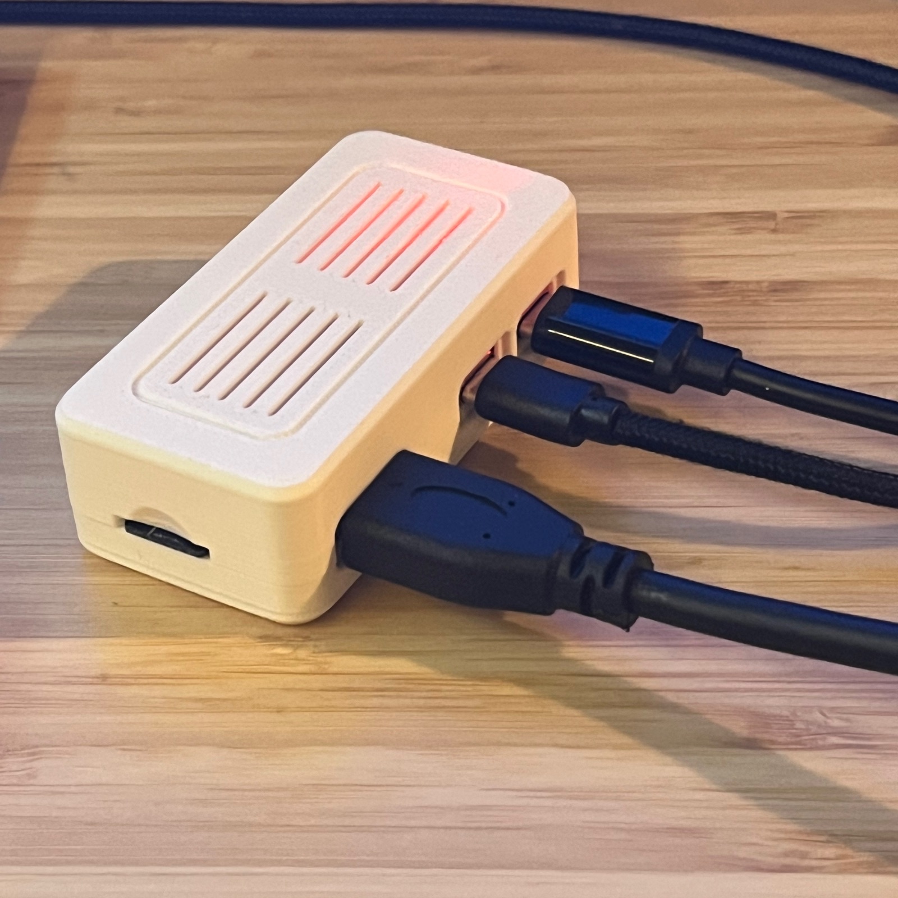
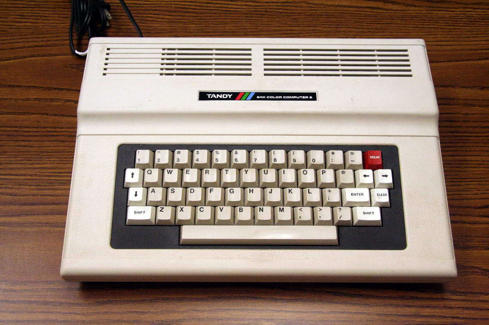
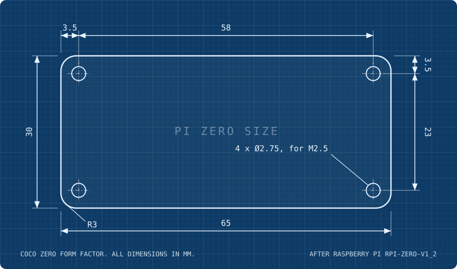
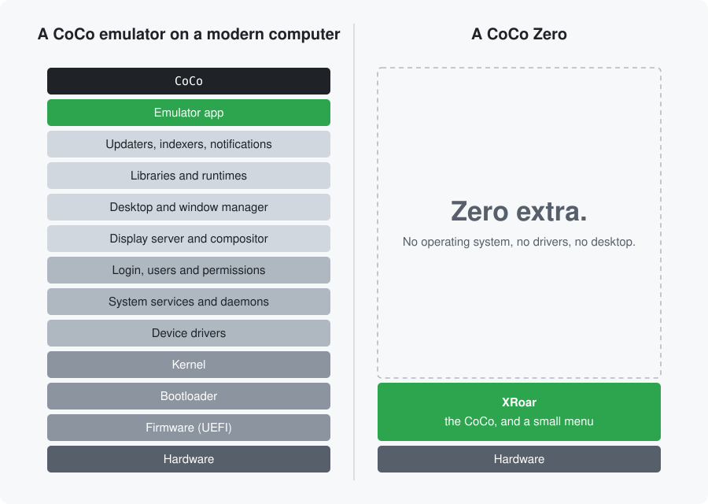
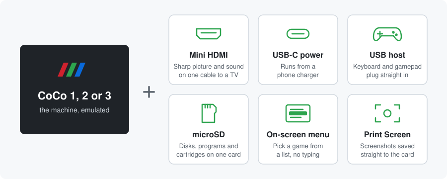
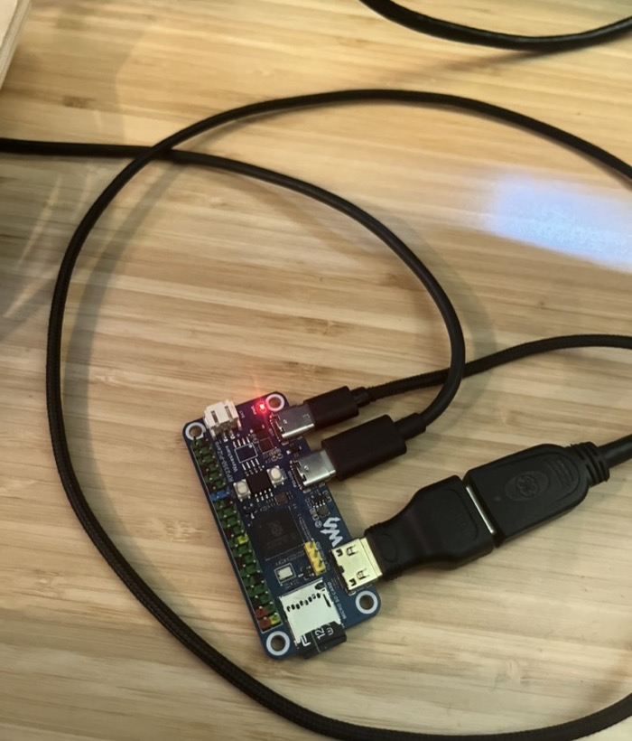
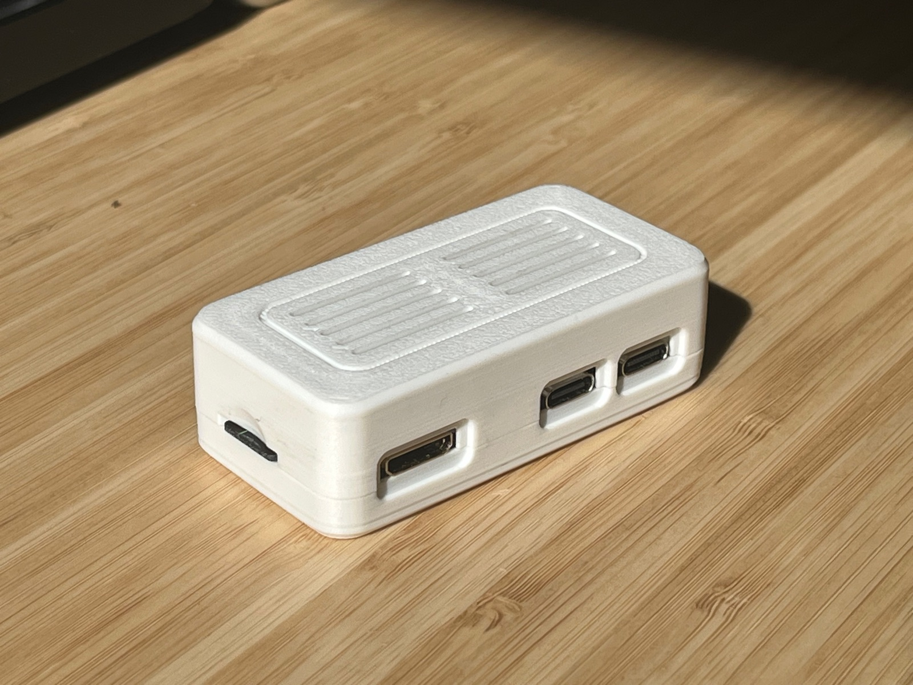

# CoCo Zero

**A Tandy Color Computer emulator on a board the size of a Raspberry Pi Zero.**

  

A CoCo Zero is a Tandy Color Computer emulator on a board the size of a
Raspberry Pi Zero. Switch it on and BASIC is there, with no operating system
in between. It is at least a 128K CoCo 3. It plugs into an ordinary TV with a
mini HDMI cable, takes a USB keyboard and gamepad, and keeps its disks and
programs on a microSD card. Anyone can build one, on any board of that size,
and every one has the same outline and mounting holes.
([What is a CoCo Zero](docs/definition.md))

## The vision

Every CoCo 2 was the same machine on the outside. Tandy built it in more than
one factory and more than one revision, including the boards made in Korea,
but the motherboard was always the same size and shape and fitted the same
case. The CoCo Zero carries that idea forward. There can be many CoCo Zeros,
from different builders on different boards, and they all share the same
board size and mounting holes.

  
   
  The Tandy 64K Color Computer 2. Photo by Lamune, via
  <a href="https://commons.wikimedia.org/wiki/File:TRS-80_Color_Computer_2-64K.jpg">Wikimedia Commons</a>.

The **Zero** means two things.

**The board size.** Raspberry Pi set the Pi Zero size in 2015, and others
have followed it since, from Waveshare to Orange Pi. A CoCo Zero is built on
a board of that size: 65 x 30 mm, with the same four mounting holes.

  

**Zero operating system.** There is nothing between you and the machine but
one layer of software: the emulated CoCo, and a lightweight monitor and
configuration screen that runs nothing else. Switch it on and BASIC is there,
just as it was in 1983. The CoCo Zero gets as close to that as it can while
keeping the essence of what it means to operate a CoCo.

  

**A CoCo, and more.** A CoCo Zero is at least a 128K CoCo 3, and ideally
512K, 2M or more. It can be a 64K CoCo 1 or 2 as well. A CoCo Zero also does things the original
machines never did: a sharp digital picture and clean sound on an ordinary
TV, a USB keyboard and gamepad, a microSD card in place of tapes and floppies.
That list will keep growing: see [Beyond the CoCo](docs/extras.md). See
[CoCo 2, CoCo 3, CoCo Zero](docs/comparison.md) for the comparison, row by row.

  

**A standard, not a blueprint.** Think of a shipping container, or an AA
battery. The standard fixes the outside: the size, and where it fastens or
connects. What goes inside is up to whoever makes it.
This standard is deliberately sparse. It leaves the most room for DIY
builders to adapt a CoCo Zero and make it their own, while letting them rely
on third-party manufacturers for the electronics, as with any computer case.

**For everyone.** A CoCo Zero is for builders, for developers writing
software for the CoCo, for retro gamers, and for anyone curious enough about
the CoCo to spend $20 finding out.

**Quiet.** Every CoCo Zero is passively cooled. No fan.

**Open.** Every CoCo Zero's firmware is open source, in the tradition of
[XRoar](https://www.6809.org.uk/xroar/), the emulator it grew from. A firmware
built on XRoar is open already: XRoar is GPL 3, so its source travels with it.

The rules behind these choices are set out in
[Design principles](docs/principles.md).

## The standard

The standard is one page:
[`spec/coco-zero-spec.pdf`](spec/coco-zero-spec.pdf). A CoCo Zero is anything
that meets every requirement on it. There are no tiers and no certification.
The rest of this repository explains the standard and the vision behind it,
but is not part of it. This is version 1.0; how it changes is set out in
[Versions and changes](docs/versioning.md).

| Page | What it sets |
|---|---|
| [Form factor](spec/form-factor.md) | The Raspberry Pi Zero outline and mounting holes |
| [Machines](spec/machines.md) | A CoCo 3 with at least 128K; a CoCo 1 or 2, if offered, with at least 64K |
| [Zero operating system](spec/zero-os.md) | No operating system; one configuration screen for emulator options, disk images, system information and loading programs and cartridges; nothing else |
| [Features](spec/features.md) | Two USB-C ports (power and programming, and a USB host), mini HDMI, microSD; a USB keyboard, joystick or gamepad, simple hub and class-compliant audio; 640 x 480 at 60 Hz DVI with embedded sound; real time at double speed with no dropped frames or sound gaps; passive cooling; open-source firmware |

The whole standard is also on one page as a PDF:
[`spec/coco-zero-spec.pdf`](spec/coco-zero-spec.pdf), built from the pages
above by [`tools/spec_pdf.py`](tools/spec_pdf.py).

The work is tracked in [`issues.jsonl`](issues.jsonl) and ranked in
[`roadmap.jsonl`](roadmap.jsonl), and
[`issues.html`](issues.html) shows both (download the repository and open it
in a browser). To contribute, see [CONTRIBUTING.md](CONTRIBUTING.md).

## The reference CoCo Zero

The first CoCo Zero is XRoar running on a
[Waveshare RP2350-PiZero](https://www.waveshare.com/rp2350-pizero.htm). It
emulates a CoCo 2 or a 128K CoCo 3 in one firmware, with a printable case
styled after the ventilated top of a CoCo 2.

  
  

Source, build instructions and the case:
[ugufru/xroar-waveshare-rp2350-pizero](https://github.com/ugufru/xroar-waveshare-rp2350-pizero)

Every known CoCo Zero is listed in [`implementations/`](implementations/README.md),
with how to add yours.

The name began there, as a name for a CoCo on a Pi Zero size board. It became
the name for the idea once the same board ran a CoCo 3 too.

## ROMs

No CoCo Zero ships with ROMs. Color, Extended, Disk and Super Extended Color
BASIC are © Microsoft, Tandy and Microware and may not be redistributed. Use
dumps from hardware you own.

## Resources

- [Glossary](docs/glossary.md): the CoCo and CoCo Zero terms used here, with a
  short background for newcomers.
- [XRoar](https://www.6809.org.uk/xroar/): the Dragon and CoCo emulator by
  Ciaran Anscomb, the heart of the reference firmware.
- [Reference firmware](https://github.com/ugufru/xroar-waveshare-rp2350-pizero):
  XRoar on the Waveshare RP2350-PiZero.
- [Waveshare RP2350-PiZero](https://www.waveshare.com/rp2350-pizero.htm) and its
  [wiki](https://www.waveshare.com/wiki/RP2350-PiZero): the reference board.
- Raspberry Pi mechanical drawings, the source of the form factor:
  [Pi Zero](https://datasheets.raspberrypi.com/rpizero/raspberry-pi-zero-mechanical-drawing.pdf)
  and [Pi Zero 2 W](https://datasheets.raspberrypi.com/rpizero2/raspberry-pi-zero-2-w-mechanical-drawing.pdf).
- [CoCopedia](https://www.cocopedia.com/): the Color Computer wiki.
- [Color Computer Archive](https://colorcomputerarchive.com/): software,
  manuals and magazines.

## License

The documents and drawings in this repository are licensed under
[CC BY 4.0](LICENSE): share and adapt them freely, with credit. The CoCo 2
photo is not ours; it is used under its own terms, credited where it appears.

## Trademarks

Tandy and Color Computer belong to their owners. "Raspberry Pi" is a
trademark of Raspberry Pi Ltd. A CoCo Zero is not a Tandy or Raspberry Pi
product. How to use the CoCo Zero name, and other people's, is set out in
[The name](docs/name.md).
